  
  

  
  

Certifications and education

 

| Certification | Issued by |
| :-- | :-- |
| Frontend Developer (React) | HackerRank |
| Introduction to Node.js (LFW111) | The Linux Foundation |
| React.js & Node.js | The Digital Adda |
| MERN Stack Development | DUCAT IT Training |

BCA · Chaudhary Charan Singh University, Meerut · 2022–2025

